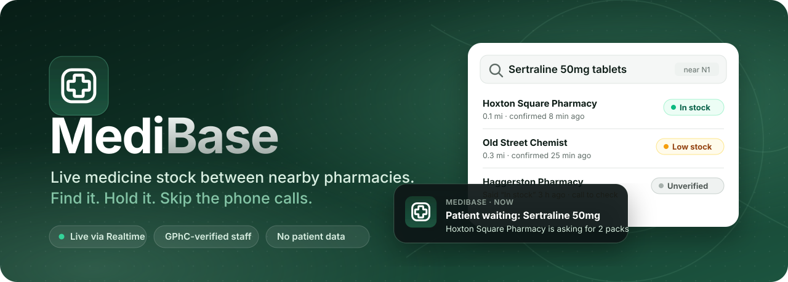
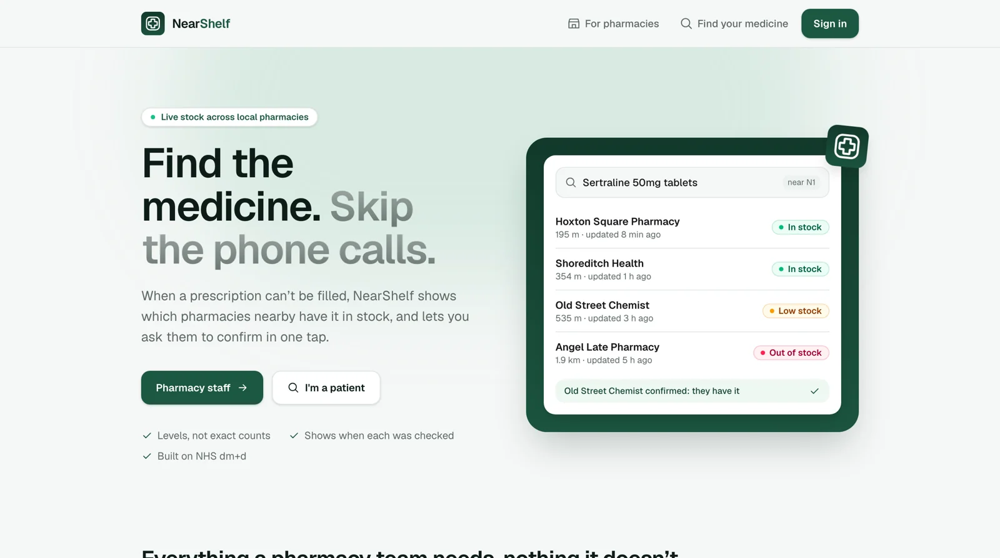
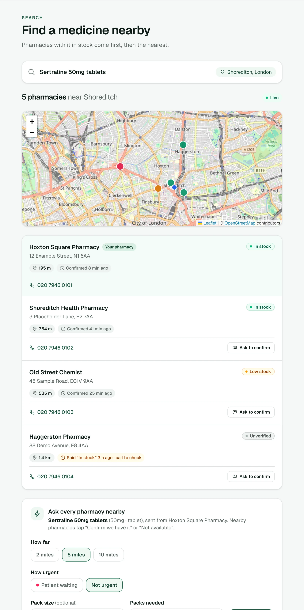
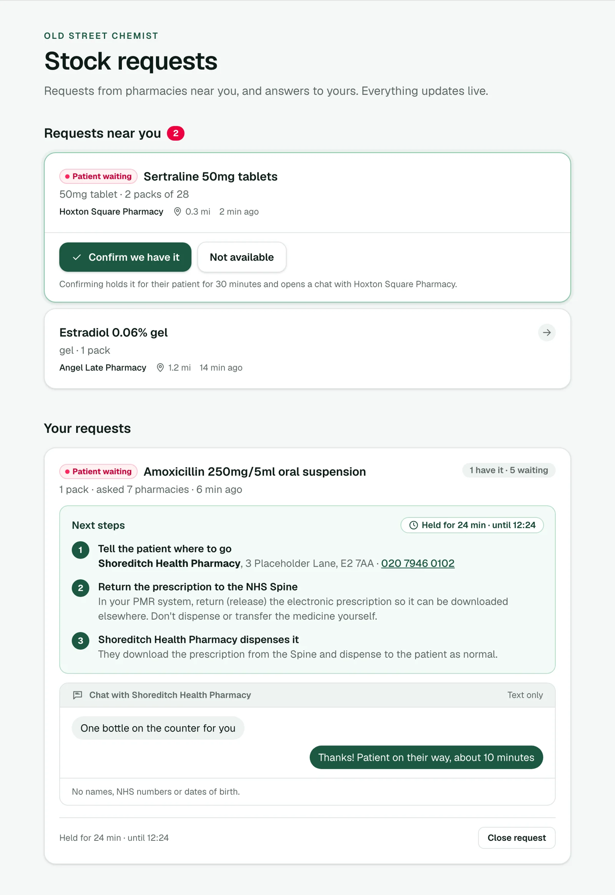
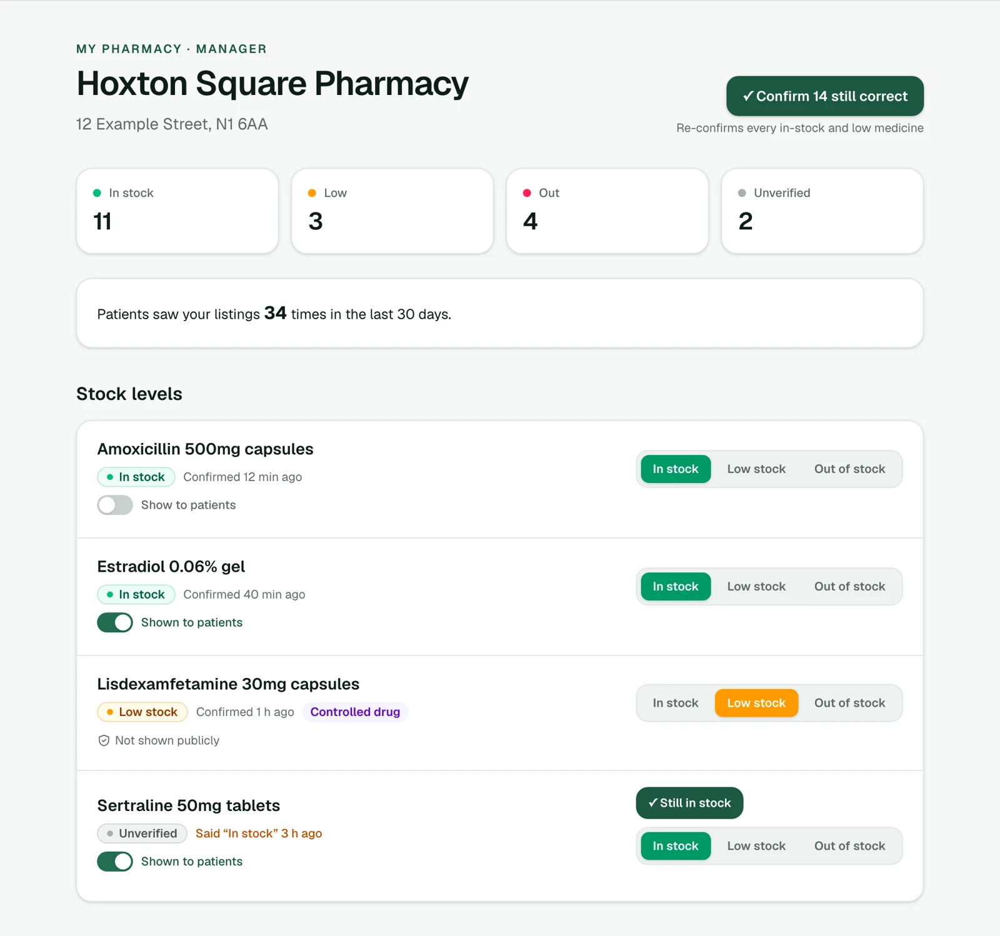
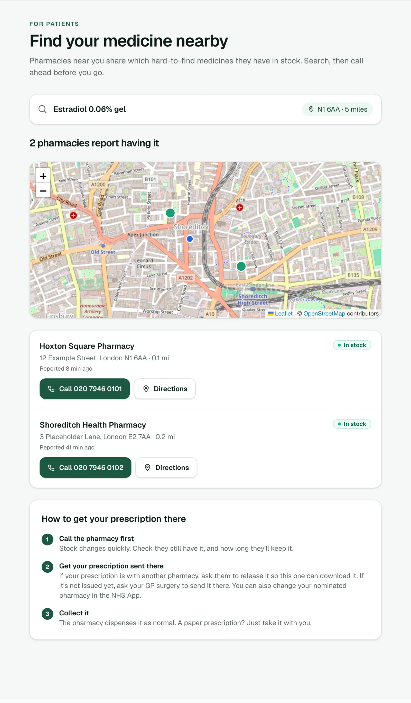
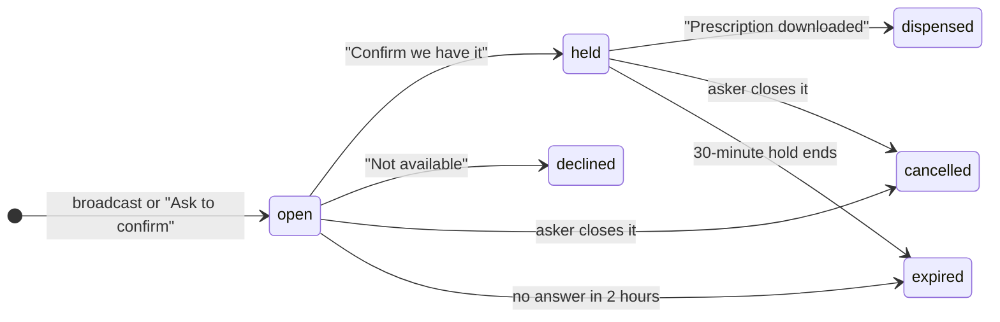
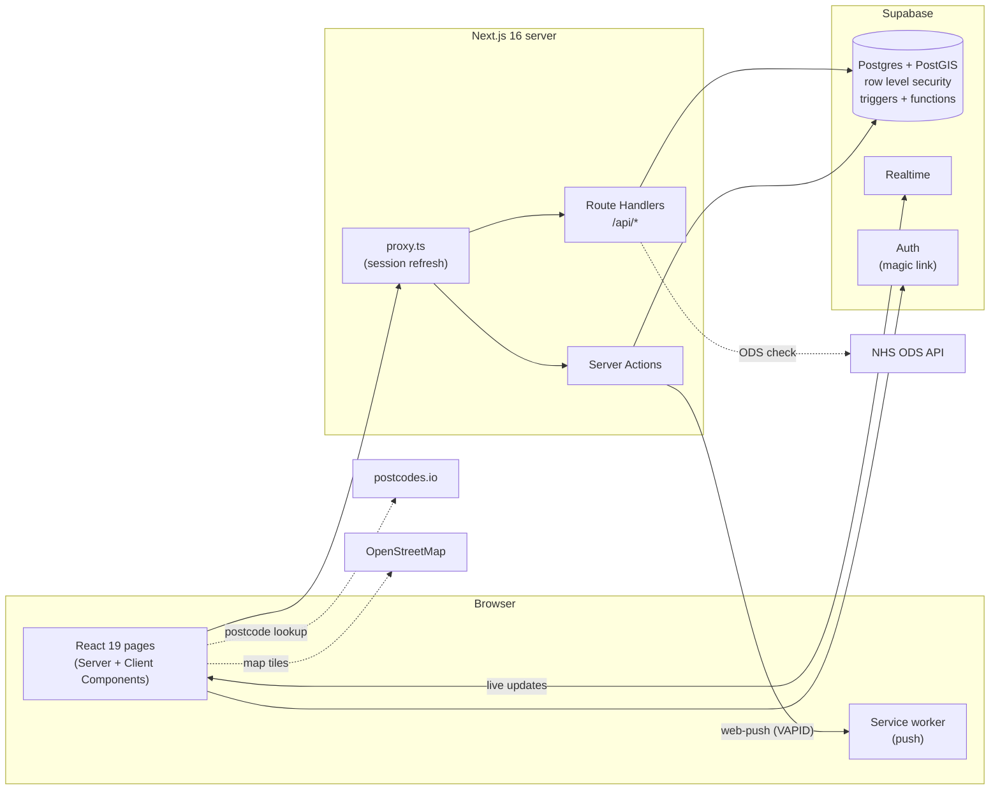

<p align="center">
  
</p>

<p align="center">
  
  
  
  
  
  
</p>

<p align="center">
  <a href="#who-its-for">Features</a> ·
  <a href="#the-legal-model">Legal model</a> ·
  <a href="#architecture">Architecture</a> ·
  <a href="#getting-started">Getting started</a> ·
  <a href="#database-tests">Tests</a>
</p>

<picture>
  <source media="(prefers-color-scheme: dark)" srcset="docs/assets/screens/home-dark.webp" />
  
</picture>

<table>
  <tr>
    <td width="50%" valign="top">
      <b>🔎 Staff search</b> · live map, verified stock, one-tap broadcast<br /><br />
      <picture>
        <source media="(prefers-color-scheme: dark)" srcset="docs/assets/screens/search-dark.webp" />
        
      </picture>
    </td>
    <td width="50%" valign="top">
      <b>⚡ Request feed</b> · urgent first, 30-minute hold, safe chat<br /><br />
      <picture>
        <source media="(prefers-color-scheme: dark)" srcset="docs/assets/screens/requests-dark.webp" />
        
      </picture>
    </td>
  </tr>
  <tr>
    <td width="50%" valign="top">
      <b>🏪 My pharmacy</b> · stock levels, Still in stock, Show to patients<br /><br />
      <picture>
        <source media="(prefers-color-scheme: dark)" srcset="docs/assets/screens/pharmacy-dark.webp" />
        
      </picture>
    </td>
    <td width="50%" valign="top">
      <b>🧑‍⚕️ For patients</b> · no account, call ahead, move your prescription<br /><br />
      <picture>
        <source media="(prefers-color-scheme: dark)" srcset="docs/assets/screens/find-dark.webp" />
        
      </picture>
    </td>
  </tr>
</table>

<sub>Screenshots use sample data. All pharmacies are fictional.</sub>

---

When a UK pharmacy can't fill a prescription because of a shortage, staff ring
neighbouring pharmacies one by one, or hand the prescription back to the patient
to hunt for it themselves. **NearShelf** is a smart directory and communication
bridge: pharmacies share what's on their shelves, broadcast what they need, and
patients can see who has a hard-to-find medicine nearby.

> **Demo project.** All pharmacies in the seed data are fictional. NearShelf is not a
> medical device and is not for clinical use.

## Contents

- [Who it's for](#who-its-for)
- [The legal model](#the-legal-model)
- [How a request works](#how-a-request-works)
- [Architecture](#architecture)
- [Getting started](#getting-started)
- [Database tests](#database-tests)
- [Push notifications](#push-notifications)
- [Deploying](#deploying)
- [Project structure](#project-structure)
- [Scripts](#scripts)
- [Roadmap](#roadmap)

## Who it's for

### Pharmacy staff (signed in, verified)

| Feature                      | What it does                                                                                                                                                              |
| ---------------------------- | ------------------------------------------------------------------------------------------------------------------------------------------------------------------------- |
| **Find stock nearby**        | Search by name, or scan a pack (camera or USB scanner, EAN-13 and GS1 DataMatrix). Results on a map and a list: in stock first, then nearest.                             |
| **Stock levels, not counts** | In stock / Low / Out. Less commercially sensitive than counts, and easier to keep accurate.                                                                               |
| **2-hour verification**      | A report is "verified" for 2 hours, then shows as **Unverified**. One tap re-confirms a medicine; **Confirm all** handles the morning shelf check.                        |
| **Broadcast a request**      | "Who has this?" to every pharmacy within **2, 5 or 10 miles**, with pack size, quantity and urgency (_Patient waiting_ / _Not urgent_).                                   |
| **Request feed**             | Incoming requests sorted by open, then urgency, then distance. Tap one to reveal **Confirm we have it**.                                                                  |
| **30-minute hold**           | Confirming holds the stock for the patient. The asking pharmacy sees the redirection steps and a live countdown. Requests close as _dispensed_, _cancelled_ or _expired_. |
| **Handover chat**            | Text-only chat between the two pharmacies while stock is held. **Patient details are refused**, in the browser and in the database.                                       |
| **Push notifications**       | Alerts for new requests and answers, even when NearShelf is closed (installable as an app; works on iPhone from the Home Screen).                                         |
| **Show to patients**         | Choose, medicine by medicine, what appears on the public finder, and see how often patients viewed it.                                                                    |

### Patients (no account)

| Feature                          | What it does                                                                                                                                         |
| -------------------------------- | ---------------------------------------------------------------------------------------------------------------------------------------------------- |
| **Find your medicine** (`/find`) | Search a medicine and postcode; see pharmacies that **chose to list it** and **confirmed it in the last 2 hours**, with **Call** and **Directions**. |
| **How to move a prescription**   | Clear steps: call first, then ask the current pharmacy to release it, ask the GP surgery to send it, or change nomination in the NHS App.            |
| **Nothing stored**               | No accounts, no forms. Location is used for the search, then forgotten. Only anonymous per-day view counts are kept for pharmacies.                  |

### Managers and admins

| Feature                     | What it does                                                                                                                                                                                                     |
| --------------------------- | ---------------------------------------------------------------------------------------------------------------------------------------------------------------------------------------------------------------- |
| **Verified sign-up**        | Staff apply with their name, **GPhC registration number** and their branch's **NHS ODS code**. Any active pharmacy in the NHS directory can join: the first time someone applies, it's added from its NHS entry. |
| **Approvals**               | A NearShelf admin approves a pharmacy's first member, who becomes its **manager**. From then on, its managers check the GPhC register and approve their own staff.                                               |
| **GP practices and locums** | Pharmacists outside community pharmacy register with their GPhC number (and their GP practice's ODS code) for **view-only** stock search. Admins approve them, and each pharmacy can switch this off.            |

## The legal model

UK medicine supply is regulated by the MHRA, so NearShelf is built around what it must **not** do.

### Not a marketplace (the WDA rule)

Pharmacies can't trade, sell or swap Prescription Only Medicines with unrelated
pharmacies without a **Wholesale Dealer's Licence**. NearShelf therefore has **no
payments, orders or stock transfers**, anywhere.

### Visibility and redirection: move the prescription, not the medicine

1. Pharmacy A broadcasts that it needs a medicine.
2. Pharmacy B taps **Confirm we have it**, and holds a pack for 30 minutes.
3. Pharmacy A tells the patient where to go.
4. Pharmacy A returns the electronic prescription to the **NHS Spine**.
5. The patient goes to Pharmacy B, which downloads the prescription and dispenses it legally.

NearShelf shows these steps to staff at exactly the moment they need them.

### Guardrails enforced in the database

| Rule                                     | How                                                                                                                                                                                    |
| ---------------------------------------- | -------------------------------------------------------------------------------------------------------------------------------------------------------------------------------------- |
| **No patient data**                      | Requests hold stock details only. Chat messages that look like an NHS number, date of birth, postcode or phone number are rejected by a database trigger (`contains_patient_details`). |
| **Staff only change their own pharmacy** | Row level security (`is_staff_of`) on every write.                                                                                                                                     |
| **Verified staff only**                  | Joining a pharmacy needs an approved application (`review_staff_application`).                                                                                                         |
| **Stock is for verified people**         | Only pharmacy staff, admins and approved clinicians can read stock levels (`can_see_stock`); clinicians only see pharmacies that share with them, and can't change anything.           |
| **Controlled drugs never public**        | They can't be listed publicly, and the public search refuses them (theft risk).                                                                                                        |
| **Honest stock**                         | Unverified (older than 2 hours) stock ranks lower for staff and is hidden from the public.                                                                                             |

## How a request works



`expired` is never stored: it's worked out from timestamps whenever the data is
read (`request_state()`), so expiry happens on time with no scheduled jobs. The
same idea gives stock its 2-hour verification (`stock_verified_window()`).

## Architecture



| Layer        | Choice                                                                    | Why                                                                                                                                                                     |
| ------------ | ------------------------------------------------------------------------- | ----------------------------------------------------------------------------------------------------------------------------------------------------------------------- |
| Framework    | **Next.js 16** (App Router, Cache Components, Server Actions, `proxy.ts`) | Server-rendered pages with streamed signed-in parts; no separate API server.                                                                                            |
| Language     | **TypeScript** (strict) + **Zod**                                         | Types are generated from the database (`npm run db:types`), so a wrong table or column is a compile error. Zod validates everything from the browser or other services. |
| Database     | **Supabase Postgres + PostGIS**                                           | Distance queries (`st_dwithin`) and one place for the rules.                                                                                                            |
| Security     | **Row level security first**                                              | Rules live in the database, so they hold even if app code has a bug. `security definer` functions do the few privileged things, each with its own checks.               |
| Live updates | **Supabase Realtime**                                                     | Search results, the request feed, chat and the header badge update without refreshing.                                                                                  |
| Push         | **Web Push (VAPID)** + service worker                                     | Works with NearShelf closed. The only use of the server's secret key is to find which devices to notify (`push_targets`, callable by nothing else).                     |
| Maps         | **Leaflet** + OpenStreetMap                                               | Used directly (react-leaflet breaks under React 19 Strict Mode). Popups use `textContent`, so names can't inject HTML.                                                  |
| Barcodes     | **ZXing**                                                                 | Loaded only when the scanner opens.                                                                                                                                     |
| Styling      | **Tailwind CSS 4**                                                        | Design tokens (green and silver from the logo) in `globals.css`, with dark mode.                                                                                        |

## Getting started

You need **Node.js 20+** and a free **[Supabase](https://supabase.com)** project
(or Docker, for a local database).

```bash
npm install
cp .env.example .env.local
```

### 1. Database

**Hosted Supabase (no Docker).** In the dashboard's **SQL Editor**, run every file in
[`supabase/migrations/`](supabase/migrations) **in name order** (the names start with
dates), then [`supabase/seed.sql`](supabase/seed.sql):

| #   | Migration                              | Adds                                                                 |
| --- | -------------------------------------- | -------------------------------------------------------------------- |
| 1   | `…26_initial_schema`                   | Pharmacies, medicines, staff, stock, requests, RLS, search functions |
| 2   | `…27_stock_requires_sign_in`           | Stock readable by signed-in staff only                               |
| 3   | `…28_stock_request_rules`              | Request rules (always start pending, only the answer can change)     |
| 4   | `…29_medicine_barcodes`                | GTIN → medicine, with demo barcodes                                  |
| 5   | `…30_verified_stock_reserve_broadcast` | 2-hour verification, 30-minute hold, broadcasts                      |
| 6   | `…31_staff_applications`               | Verified sign-up and approvals                                       |
| 7   | `…01_request_lifecycle_and_chat`       | Urgency, lifecycle, request feed, handover chat                      |
| 8   | `…02_push_subscriptions`               | Web push devices                                                     |
| 9   | `…03_public_listings`                  | Patient finder and public listings                                   |

**Local Supabase (Docker).** This applies the migrations and seed for you:

```bash
npm run db:start
```

```bash
npm run db:reset
```

### 2. Settings

Fill in `.env.local`. From Supabase: **Project Settings → API Keys**.

| Variable                                            | What it is                                            | Needed for         |
| --------------------------------------------------- | ----------------------------------------------------- | ------------------ |
| `NEXT_PUBLIC_SUPABASE_URL`                          | Your project URL                                      | Everything         |
| `NEXT_PUBLIC_SUPABASE_ANON_KEY`                     | The **publishable** key (safe in the browser)         | Everything         |
| `NEXT_PUBLIC_VAPID_PUBLIC_KEY`, `VAPID_PRIVATE_KEY` | Web push key pair: `npx web-push generate-vapid-keys` | Push notifications |
| `VAPID_SUBJECT`                                     | `mailto:` address push services can contact           | Push notifications |
| `SUPABASE_SECRET_KEY`                               | **Server-only** secret key. Never share or commit it  | Push notifications |

Without the push settings, everything else still works and no notifications are sent.

### 3. Database types

The app's TypeScript types are generated from your database. `db:types` has a
project ID in it: in [`package.json`](package.json), replace `ylzusggwdoupdytszwha`
with yours (the part before `.supabase.co` in your URL), then:

```bash
npx supabase login
```

```bash
npm run db:types
```

### 4. Run it

```bash
npm run dev
```

Open http://localhost:3000. The home page shows a **Setup check** (development only).

### 5. Demo accounts

In Supabase, **Authentication → Users → Add user**, create two users with
**Auto Confirm**: `hoxton@example.com` and `oldstreet@example.com`. Link them to two
demo pharmacies in the SQL Editor:

```sql
insert into public.pharmacy_staff (user_id, pharmacy_id, role)
select u.id, p.id, 'manager'
from auth.users u
join public.pharmacies p
  on (u.email = 'hoxton@example.com'    and p.ods_code = 'DEMO01')
  or (u.email = 'oldstreet@example.com' and p.ods_code = 'DEMO02')
on conflict do nothing;
```

In development, the sign-in page has a **Developer sign-in** with passwords, so you
don't use up Supabase's small email allowance. It's switched off in production.
To try `/admin`, make yourself an admin:

```sql
insert into public.platform_admins (user_id)
select id from auth.users where email = 'you@example.com';
```

**A good walkthrough:** sign in as Hoxton in one window and Old Street in another
(e.g. Incognito). As Hoxton, search _sertraline_ near _Shoreditch_ and **Ask every
pharmacy nearby** with _Patient waiting_. As Old Street, open **Requests**, tap the
request, **Confirm we have it**, and chat. Then try `/find` signed out after Hoxton
switches on **Show to patients**. Print or display `/barcodes` to test scanning.

**`/find` shows nothing?** That's the safety rules working: patients only see
medicines a pharmacy **listed**, and only while stock was **confirmed in the last 2
hours** (the seed data is older than that). For a quick demo, run
[`supabase/demo/refresh_public_demo.sql`](supabase/demo/refresh_public_demo.sql) in
the SQL Editor: it lists the demo pharmacies' non-controlled stock and re-confirms
it, so `/find` has results for the next 2 hours.

## Database tests

The security rules live in the database, so they're tested there. Each file in
[`supabase/tests/`](supabase/tests) acts as the two demo accounts (and as a
signed-out visitor), checks the rules, then **undoes everything**: it ends by
raising an "error" whose message is the list of results.

1. Create the demo accounts (above).
2. Paste a test file into the **SQL Editor** and run it.
3. Read the message: every line should end in **PASS**.

| File                                  | Checks                                                                                                                                             |
| ------------------------------------- | -------------------------------------------------------------------------------------------------------------------------------------------------- |
| `verified_reserve_broadcast.sql` (11) | 2-hour verification and ranking, Still in stock, broadcasts reach the right pharmacies, no duplicates, the 30-minute hold, answers can't change    |
| `staff_applications.sql` (14)         | Applications start pending, one per person, GPhC numbers used once, privacy, only managers/admins review, never your own                           |
| `request_lifecycle_and_chat.sql` (17) | Urgent sorted first, chat signed by the right pharmacy, **patient details refused**, closing rules, 2-hour expiry, closing broadcasts              |
| `public_listings.sql` (11)            | Only listed stock is public, **controlled drugs never**, old or out-of-stock hidden, anonymous view counts stay private                            |
| `open_signup_and_clinicians.sql` (13) | Clinicians start pending, see no stock until approved, then only from sharing pharmacies; only the server adds pharmacies; first member is manager |

App code checks:

```bash
npm run typecheck
```

```bash
npm run lint
```

## Push notifications

1. Set the four push variables (see [Settings](#2-settings)) and restart `npm run dev`.
2. Open **Requests** → **Turn on notifications** → allow → **Send test**.
3. Broadcasts notify staff at every pharmacy in range; _Confirm we have it_ notifies the asking pharmacy.

On **iPhone**, push needs the app installed: open the site in Safari, **Share → Add
to Home Screen**, then open NearShelf from the Home Screen. Notifications only ever
contain stock details.

## Deploying

1. Import the repository at [vercel.com/new](https://vercel.com/new).
2. Add the environment variables from [Settings](#2-settings), with `VAPID_SUBJECT` set to your real contact.
3. In Supabase, **Authentication → URL Configuration**, add `https://<your-app>.vercel.app/**` to **Redirect URLs**, so sign-in links work.

## Project structure

```
src/
  app/
    page.tsx                 landing page
    find/                    public patient finder
    search/                  staff search (map, list, broadcast)
    requests/                request feed, holds, chat; actions.ts
    my-pharmacy/             stock levels, public listings, approvals
    join/                    verified sign-up (GPhC + ODS)
    admin/                   admin approvals
    sign-in/  auth/          magic-link sign-in and callback
    barcodes/                printable demo barcodes
    api/                     medicines, nearby, barcodes, public/find
    notifications/           push subscription actions
    manifest.ts              installable web app
  components/                UI (ui.tsx = buttons, icons, cards, skeletons)
  hooks/                     useDebouncedValue, useTableChanges, useNow
  lib/
    auth.ts                  who is signed in (getClaims)
    push.ts                  web push sender (server only)
    patient-data.ts          patient-detail checker (mirrors the database)
    ods.ts                   NHS ODS lookup
    gtin.ts  ean13.ts        barcodes
    schemas.ts               Zod schemas for all input
    database.types.ts        generated: npm run db:types
    supabase/                browser, server and admin clients
  proxy.ts                   session refresh + signed-in-only pages
public/sw.js                 service worker (push)
supabase/
  migrations/                the schema, in order
  seed.sql                   fictional pharmacies, medicines, stock
  tests/                     rolled-back database tests
```

## Scripts

| Command                                     | What it does                                        |
| ------------------------------------------- | --------------------------------------------------- |
| `npm run dev`                               | Start the app at localhost:3000                     |
| `npm run build`                             | Production build                                    |
| `npm run typecheck`                         | Generate route types, then check all TypeScript     |
| `npm run lint`                              | ESLint                                              |
| `npm run format`                            | Prettier                                            |
| `npm run db:types`                          | Generate TypeScript types from your hosted database |
| `npm run db:start` / `db:stop` / `db:reset` | Local Supabase (Docker)                             |
| `npm run db:types:local`                    | Types from the local database                       |

## Roadmap

| Phase                  | What it adds                                                                                             | Status          | Branch                   |
| ---------------------- | -------------------------------------------------------------------------------------------------------- | --------------- | ------------------------ |
| **0 · Core app**       | Live stock, one-tap requests, 30-minute hold, handover chat, push alerts, patient finder, PMR CSV import | ✅ Live         | `phase/0-core`           |
| **1 · Insights**       | Unmet demand, response scores, referral log, NHS dispensing trends, shortage signals                     | 🟡 Preview live | `phase/1-insights`       |
| **2 · Smart stock**    | Days of stock left from PMR uploads, slow-moving stock, reorder alerts                                   | 🔜 Next         | `phase/2-smart-stock`    |
| **3 · Connected area** | Direct ProScript Connect and Titan links, group view, area early-warning                                 | 🌱 Later        | `phase/3-connected-area` |

The full plan, the release history (v0.1.0 to v0.8.0) and how the branches work are in
[`docs/ROADMAP.md`](docs/ROADMAP.md).

### Known limitations

- **Demo data.** Real use needs the full NHS **dm+d** medicines catalogue (VMP/AMPP,
  including real pack GTINs). Real pharmacies join themselves with their ODS code.
- **GPhC checks are manual**: the register has no public API.
- **Rate limiting** on the public finder is per server instance; a shared store
  (e.g. Redis) would make it exact.
- **Before wider use:** review by a pharmacy regulation adviser.
